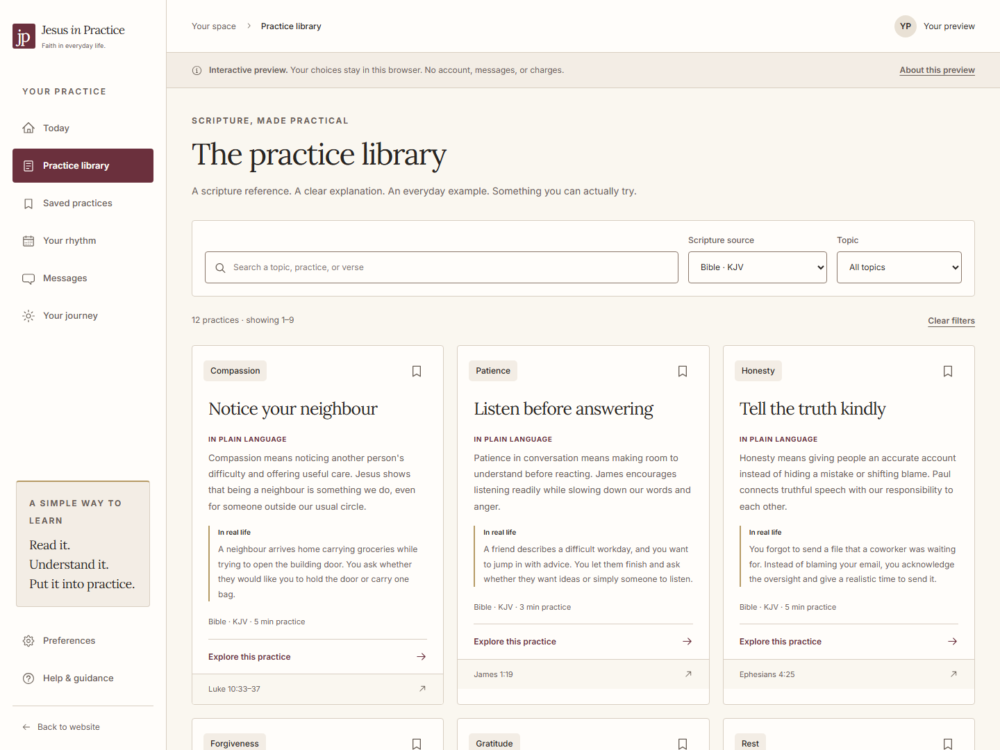
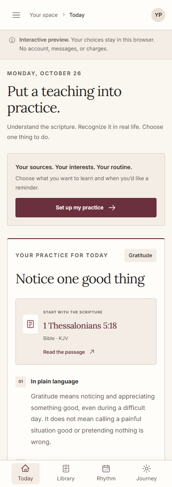
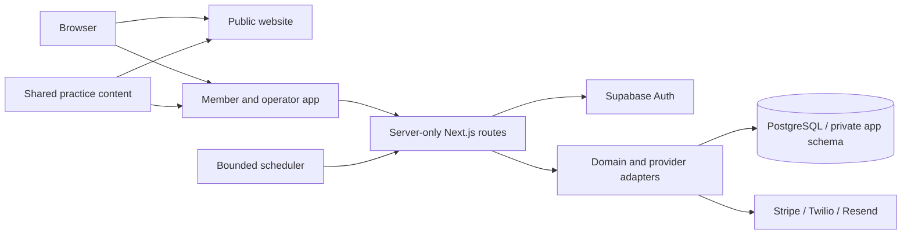

# Jesus in Practice

[](https://github.com/Arshiaheravi/jesus-in-practice-portfolio/actions/workflows/frontend.yml)

A full-stack scripture practice app: precise references, plain-language explanations, everyday examples, and one practical action at a time.

**Next.js 16 · React 19 · TypeScript · Tailwind CSS 4 · PostgreSQL · Supabase Auth · Stripe · Twilio · Resend · Playwright**


**This is a portfolio source release, with no hosted service or shared credentials.** The default preview runs locally without accounts or API keys. The authenticated backend and provider adapters are included for developers who configure their own services. Real delivery, payments, and production operations require separate integration verification.

[Quick start](#quick-start) · [Architecture](#architecture) · [Testing](#testing) · [Provider setup](docs/provider-setup.md) · [Verification evidence](docs/verification.md)

## What it does

- **Explore scripture practically.** Search and filter 24 original practices, with explicit KJV Bible or Book of Mormon source choices and precise passage links.
- **Build a personal practice.** Save lessons, write reflections, record completions, and review paginated activity.
- **Choose a sustainable schedule.** Select days, a time zone, and fixed times or a daily delivery window; pause whenever needed.
- **Keep accounts and email free.** Optional SMS uses prepaid CAD credit, with no subscription or automatic recharge.
- **Manage operations deliberately.** An MFA-protected operator workspace supports financial review, refunds, content review, and publication.
- **Draft with evidence.** The optional content pipeline validates complete source inventories, records permissions, and requires human review before publishing AI-assisted drafts.

The bundled collection is 24 practices, not the complete text or teachings of either scripture. AI drafting is disabled by default, uses approved passage context, and never publishes automatically.

## A closer look


| Practice library                                                                              | Mobile dashboard                                                                             |
| --------------------------------------------------------------------------------------------- | -------------------------------------------------------------------------------------------- |
|  |  |

The Heritage interface uses literary headings, warm reading surfaces, restrained burgundy actions, real photography, and responsive light/dark layouts. Source attribution, keyboard navigation, visible focus, and useful empty/error states are part of the interface.

## Quick start

Install Node.js 22 or 24 and Git. The workspace pins **pnpm 10.26.0** and manages **Node.js 22.23.3** for project commands. Initial dependency and font downloads require internet access.

```sh
git clone https://github.com/Arshiaheravi/jesus-in-practice-portfolio.git
cd jesus-in-practice-portfolio
npx --yes pnpm@10.26.0 install --frozen-lockfile
npx --yes pnpm@10.26.0 dev
```

On Windows PowerShell, use `npx.cmd` in place of `npx`. If pinned pnpm is already installed, use `pnpm` directly.

| Application    | Local URL                                                   |
| -------------- | ----------------------------------------------------------- |
| Public website | [127.0.0.1:3000](http://127.0.0.1:3000/)                    |
| Member preview | [127.0.0.1:3001/dashboard](http://127.0.0.1:3001/dashboard) |

No `.env.local` file is needed for the preview. It stores demo preferences and reflections in this browser only; use sample information. The displayed entry code is a demonstration, not authentication. Stop both servers with `Ctrl+C`. To review production builds locally, run `pnpm build`, then `pnpm preview`.

## Preview and configured backend

| Capability                  | Default preview                           | Configured live mode                                               |
| --------------------------- | ----------------------------------------- | ------------------------------------------------------------------ |
| Sign-in                     | Clearly labelled demonstration            | Supabase email OTP and HTTP-only session cookies                   |
| Preferences and reflections | Browser-local storage                     | Authenticated APIs, PostgreSQL persistence, revision checks        |
| History                     | Local demo activity                       | Cursor pagination and complete account export                      |
| Email and SMS               | Message and schedule previews             | Consent-aware queue, provider delivery results, opt-out handling   |
| Wallet                      | Payment interface preview; no money moves | Server-owned ledger, Stripe Checkout, SMS reservations and refunds |
| Operator tools              | No administrator bypass                   | Database-assigned roles and MFA                                    |

Use the two `.env.example` files and [provider setup guide](docs/provider-setup.md) for your own isolated integration environment. Supply your own database, Auth configuration, application secrets, operator contact, and provider credentials. Keep private values out of `NEXT_PUBLIC_*` settings and source control. Each provider capability has a separate activation flag; switching to live mode alone does not enable payments or messaging.

The repository includes optional deployment artifacts for adopters. CI does **not** deploy this portfolio or activate paid services.

## Architecture



| Location                 | Responsibility                                                                            |
| ------------------------ | ----------------------------------------------------------------------------------------- |
| `apps/website`           | Public pages, searchable practices, source references, metadata                           |
| `apps/dashboard`         | Member/operator interfaces, sessions, API routes, server configuration                    |
| `packages/backend`       | Domain contracts, repositories, financial operations, provider adapters, content pipeline |
| `packages/content`       | Shared original practices and source-aware content model                                  |
| `database/migrations`    | Versioned schema, row-level security, grants and integrity constraints                    |
| `scripts` / `deployment` | Isolated test tools, maintenance, recovery, optional hosting configuration                |

### Engineering decisions

- **Money stays authoritative on the server.** Integer CAD cents, append-only ledger records, transactional reservations, and stable operation IDs protect funding and refunds from duplicate processing. A checkout return URL is never payment evidence.
- **Authorization has multiple boundaries.** Server-verified sessions, active operator roles, MFA, and database row-level security protect private operations. The `app` schema is not exposed through the public Data API.
- **Consent is independent of payment and identity.** Verified destinations, versioned wording, separate channel grants, and persistent suppression are checked again before sending.
- **Uncertainty remains visible.** Timeouts do not prove failure or trigger an unkeyed resend. Unknown delivery/payment outcomes retain their reconciliation state. History limits and partial provider evidence are explicit.
- **Configuration fails closed.** Provider capabilities default off. Validated origins, bounded request bodies, private response caching rules, restricted credentials, and safe error categories support defensive operation.

See [backend architecture](docs/backend-handoff.md), [API contracts](docs/backend-api.md), and the [security review](docs/security-review.md) for implementation details and limits.

## Testing

```sh
pnpm check
pnpm exec playwright install chromium
pnpm test:e2e
```

`pnpm check` runs formatting, lint, types, logic/integration tests, and production builds. Browser tests run against those builds. The [testing guide](docs/testing.md) covers mocked live-mode journeys, disposable PostgreSQL, real HTTP/database checks, and encrypted backup/restore drills.

CI uses pinned tooling, frozen lockfiles, restricted workflow permissions, dependency audits, secret scanning, production builds, browser checks, and isolated PostgreSQL services. No provider credentials are required.

Tests distinguish **injected provider responses**, **mocked live browser APIs**, and **actual PostgreSQL transactions/HTTP routes**. Synthetic identity is not real Supabase OTP or MFA verification, and no local test proves carrier delivery or real payment settlement. Executed results and the tested revision belong in [verification evidence](docs/verification.md); a workflow file alone is not a passing run.

## Documentation and reuse

- [Provider setup](docs/provider-setup.md) · [Operations](docs/operations.md) · [Operator guide](docs/operator-guide.md)
- [Financial operations](docs/financial-operations.md) · [Content pipeline](docs/content-pipeline.md) · [Recovery and monitoring](docs/production-operations.md)
- [Design system](design-system/MASTER.md) · [Asset credits](docs/asset-credits.md)
- [Contributing](CONTRIBUTING.md) · [Security policy](SECURITY.md) · [License](LICENSE) · [Third-party notices](THIRD_PARTY_NOTICES.md)

Review the license and asset notices before reusing code or images. Bring your own service credentials and verify your own operational, privacy, content-rights, and commerce requirements before enabling a real service.
